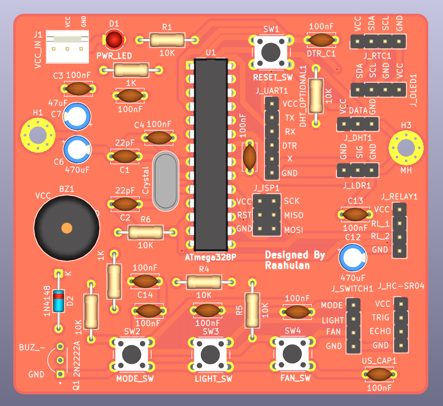
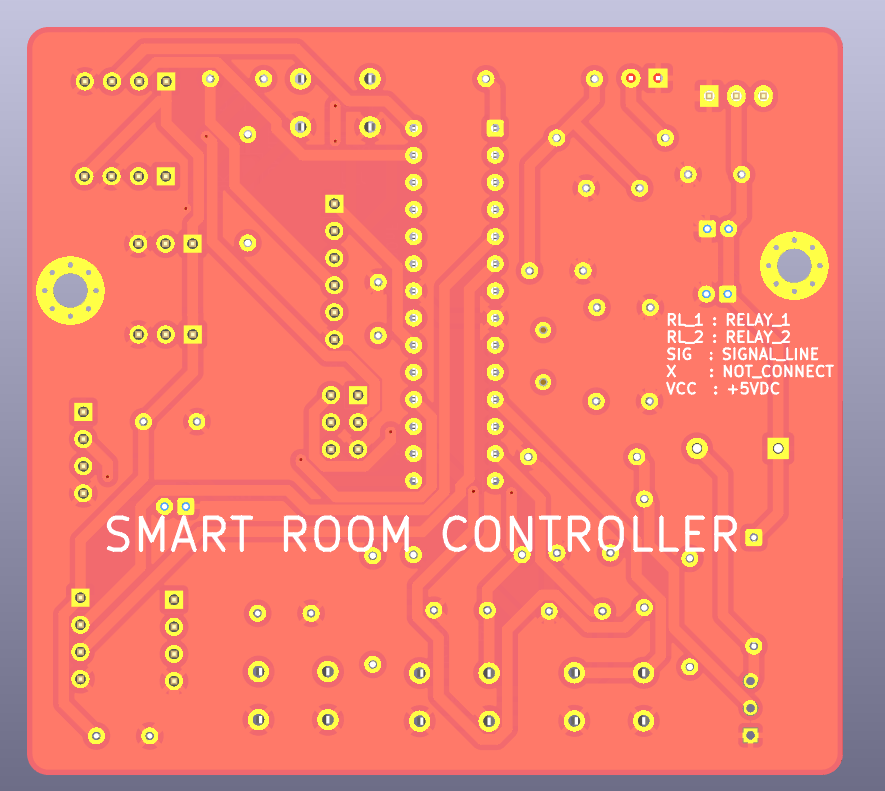
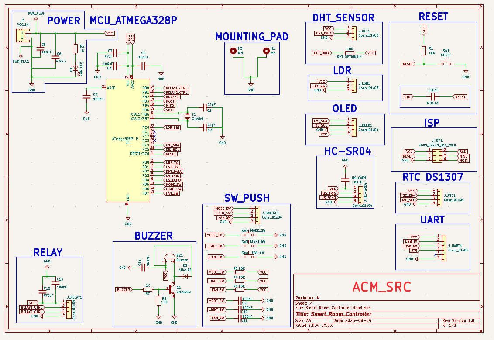
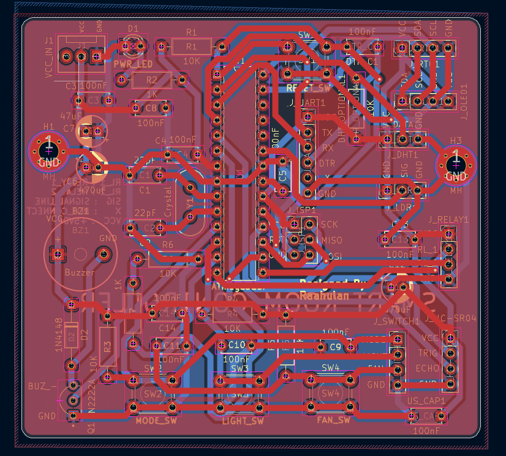
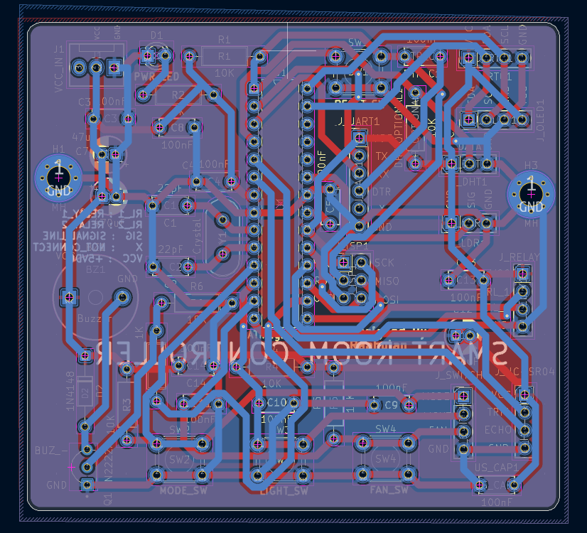
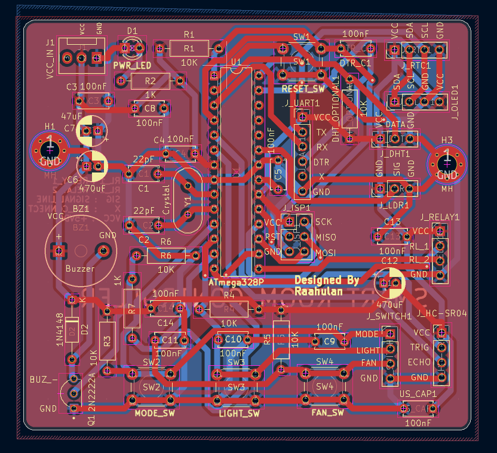
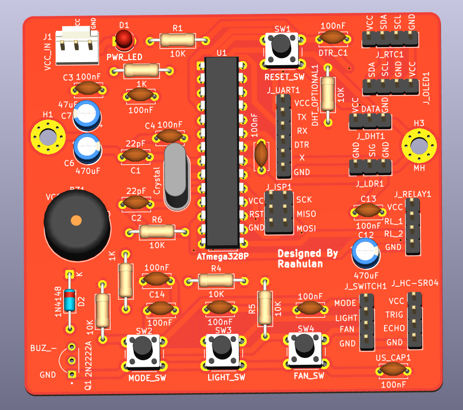

# 🏠 Smart Room Controller PCB

An ATmega328P-based **Smart Room Controller PCB** designed using **KiCad** for home and room automation applications.

The board integrates multiple sensors, relay control, user input switches, RTC, display connectivity, ultrasonic sensing, buzzer indication, UART communication and ISP programming into a single custom PCB.

---

## 📌 Project Overview

The Smart Room Controller is designed as a centralized embedded controller capable of monitoring environmental conditions and controlling room appliances.

The system is built around the **ATmega328P microcontroller** and provides interfaces for:

- Relay-controlled appliances
- DHT temperature and humidity sensor
- LDR light sensor
- HC-SR04 ultrasonic sensor
- OLED display
- DS1307 RTC module
- Manual push buttons
- Buzzer
- UART communication
- ISP programming
- Reset circuit
- External power input

---

# 🖥️ PCB 3D View

## Front 3D View

The front side contains the ATmega328P controller, oscillator circuitry, connectors, switches, buzzer and passive components.



---

## Back 3D View

The rear view of the PCB showing the solder side and routed connections.



---

# 🔌 Circuit Schematic

The schematic was designed in **KiCad** and divided into functional sections including power, MCU, sensors, relay interface, buzzer, switches and communication interfaces.



### Main schematic blocks

- Power Supply
- ATmega328P MCU
- Crystal Oscillator
- Reset Circuit
- DHT Sensor
- LDR Sensor
- OLED Interface
- HC-SR04 Interface
- RTC DS1307
- Relay Interface
- Buzzer Driver
- Push Button Inputs
- UART Interface
- ISP Programming Header

---

# 🧠 Microcontroller

The controller is based on the:

## ATmega328P

The ATmega328P performs:

- Sensor data acquisition
- Relay control
- Manual switch monitoring
- Display communication
- RTC communication
- Ultrasonic distance measurement
- Buzzer control
- Serial communication

The board also includes an external crystal oscillator with load capacitors for stable operation.

---

# ⚡ Power Section

The board contains a dedicated power input section.

Main components include:

- External VCC input
- Power indication LED
- Filtering capacitors
- Bulk electrolytic capacitors
- Decoupling capacitors

Decoupling capacitors are positioned around the microcontroller and peripheral sections to improve power stability and reduce electrical noise.

---

# 🔄 Relay Interface

The PCB provides a connector for external relay control.

Relay signals include:

| Pin | Function |
|---|---|
| VCC | Relay power |
| RL_1 | Relay 1 control |
| RL_2 | Relay 2 control |
| GND | Ground |

These outputs can be connected to relay modules for controlling appliances such as:

- Lights
- Fans
- Other room equipment

---

# 🌡️ DHT Sensor Interface

A connector is provided for a DHT-series temperature and humidity sensor.

Typical compatible sensors:

- DHT11
- DHT22

Connections:

```text
VCC
DATA
GND
```

A pull-up resistor is included for the data line.

---

# ☀️ LDR Interface

The PCB provides an interface for a light-dependent resistor circuit.

The LDR input can be used to measure room illumination and implement functions such as:

- Automatic light control
- Day/night detection
- Ambient-light monitoring

---

# 📏 HC-SR04 Ultrasonic Sensor

An HC-SR04 interface is provided for distance or presence sensing.

Connections include:

```text
VCC
TRIG
ECHO
GND
```

Possible applications include:

- Occupancy detection
- Object detection
- Distance measurement

---

# 🕐 RTC Interface

The PCB includes an I²C interface suitable for a **DS1307 Real-Time Clock module**.

Connections include:

```text
VCC
SDA
SCL
GND
```

The RTC allows the controller to maintain date and time information for automation schedules.

---

# 🖥️ OLED Display Interface

An I²C OLED connector is included.

Connections:

```text
VCC
SDA
SCL
GND
```

Typical compatible displays include SSD1306-based OLED modules.

The display can be used to show:

- Temperature
- Humidity
- Time
- Sensor status
- Appliance status
- Operating mode

---

# 🔘 Manual Control Switches

Three push buttons are available for local control.

They are intended for functions such as:

- Mode selection
- Light control
- Fan control

The board therefore supports manual interaction in addition to automatic room control.

---

# 🔊 Buzzer Circuit

The PCB includes a buzzer driver section using a transistor.

This allows the microcontroller to activate the buzzer for:

- Alerts
- Notifications
- Sensor alarms
- User feedback

---

# 🔁 Reset Circuit

A dedicated reset push button is included for manually restarting the ATmega328P.

The circuit also includes the required pull-up and capacitor components.

---

# 💻 UART Interface

A dedicated UART header provides access to serial communication.

Connections include:

```text
VCC
TX
RX
DTR
GND
```

This interface can be used for:

- Firmware uploading
- Serial debugging
- Communication with external devices

---

# 🔧 ISP Programming Interface

The board includes a standard ISP programming header.

Signals include:

```text
VCC
RESET
GND
SCK
MISO
MOSI
```

This allows the ATmega328P to be programmed using an ISP programmer.

---

# 🧩 PCB Layout

The PCB is designed as a **two-layer board**.

## Top Copper Layer

The top layer is used for component placement and signal routing.



---

## Bottom Copper Layer

The bottom layer provides additional signal routing and interconnections.



---

# 🏷️ Silkscreen

The front silkscreen provides clear component labels, connector names and interface information for easier assembly and troubleshooting.



---

# 🔍 Front PCB View



---

# 🧱 Main Hardware

| Component | Purpose |
|---|---|
| ATmega328P | Main controller |
| Crystal | MCU clock source |
| DHT Sensor | Temperature & humidity |
| LDR | Light sensing |
| HC-SR04 | Distance/presence sensing |
| DS1307 RTC | Real-time clock |
| OLED | User interface/display |
| Relay Interface | Appliance control |
| Push Buttons | Manual control |
| Buzzer | Audio indication |
| UART | Serial communication |
| ISP | MCU programming |

---

# 🛠️ PCB Design Software

The complete project was designed using:

**KiCad**

The KiCad project includes:

- Schematic design
- Footprint assignment
- PCB routing
- Copper layers
- Ground planes
- Silkscreen
- 3D visualization
- Manufacturing preparation

---

# 📂 Repository Structure

```text
Smart-Room-Controller-PCB/
│
├── README.md
├── Hardware/
│   ├── Schematic/
│   ├── PCB/
│   └── Project/
│
├── Images/
│   ├── Schematic.png
│   ├── Front-3D-View.png
│   ├── Back-3D-View.png
│   ├── Top-Layer.png
│   ├── Bottom-Layer.png
│   ├── Front-Silkscreen.png
│   └── Front-Image.png
│
├── Gerber/
└── BOM/
```

---

# 🚀 Future Improvements

Possible future developments include:

- Wi-Fi connectivity using ESP32/ESP8266
- Mobile application control
- MQTT communication
- Home Assistant integration
- Energy monitoring
- Additional relay channels
- PIR occupancy detection
- IoT cloud connectivity
- Improved power protection
- Compact SMD PCB revision

---

# 👨‍💻 Designer

**Designed by Raahulan**

PCB Design & Embedded Systems Project

---

## ⭐ About This Repository

This repository documents the complete PCB development process of the Smart Room Controller, including the circuit schematic, PCB routing, layer views and 3D visualization.

If you find the project useful, consider giving the repository a ⭐.
